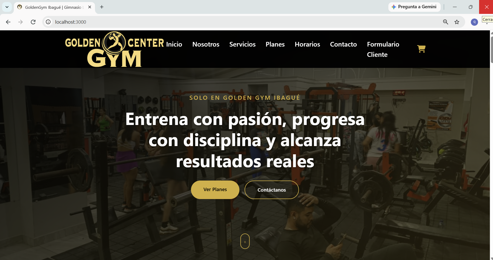
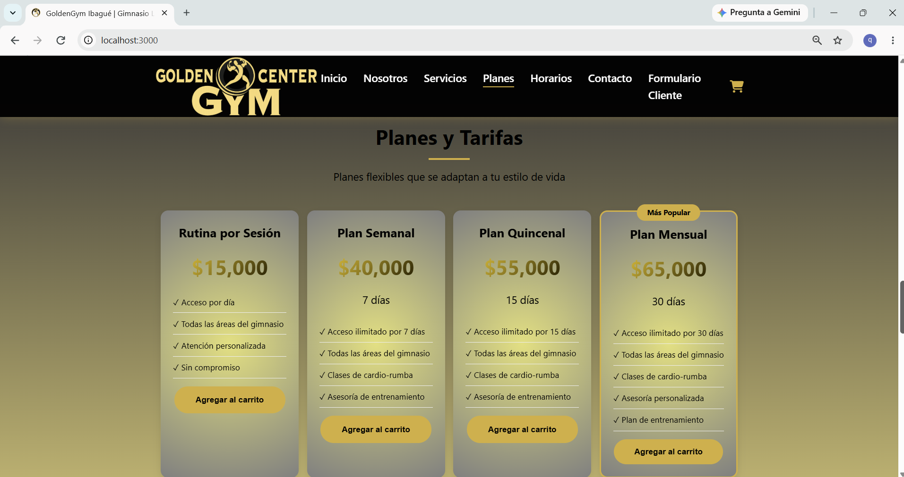
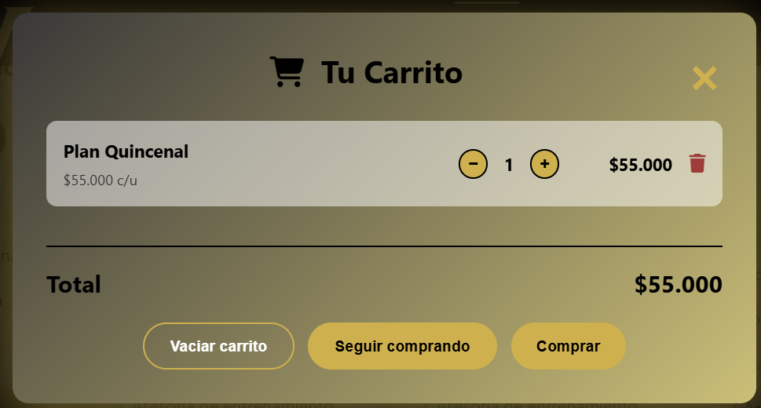
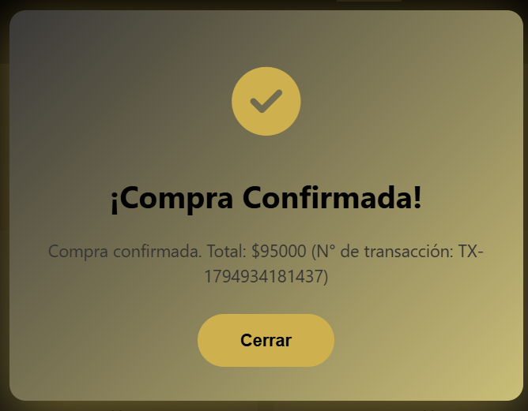
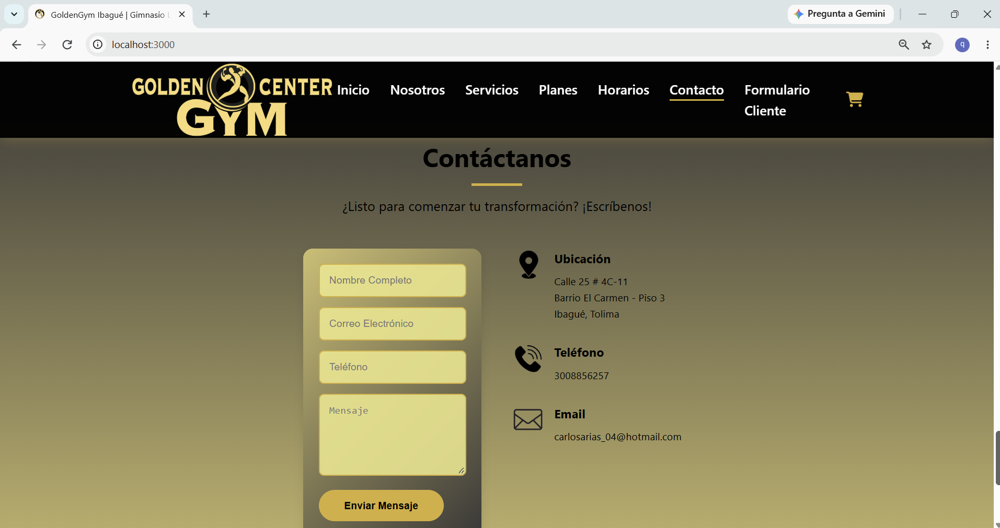

<div align="center">


[](https://nodejs.org/)
[](https://expressjs.com/)
[](https://developer.mozilla.org/es/docs/Web/JavaScript)
[](https://jestjs.io/)
[](https://www.docker.com/)
[](https://golden-gym-ggz7.onrender.com)

### 🔗 [Ver la aplicación en línea](https://golden-gym-ggz7.onrender.com)

</div>

---

## 📑 Tabla de contenido

- [Descripción](#-descripción)
- [Capturas de pantalla](#-capturas-de-pantalla)
- [Funcionalidades principales](#-funcionalidades-principales)
- [Tecnologías utilizadas](#-tecnologías-utilizadas)
- [Arquitectura del backend](#-arquitectura-del-backend)
- [Patrones de diseño](#-patrones-de-diseño)
- [Estructura del proyecto](#-estructura-del-proyecto)
- [Instalación y uso](#-instalación-y-uso)
- [Pruebas](#-pruebas)
- [Docker](#-docker)
- [Despliegue en Render](#-despliegue-en-render)
- [Desarrolladores](#-desarrolladores)
- [Licencia](#-licencia)

---

## 📖 Descripción

**Golden Center Gym** es una aplicación web para un gimnasio. Reúne en un solo lugar la información de servicios, planes, horarios, instalaciones y contacto, y permite registrar nuevos clientes, enviar mensajes de contacto y simular la compra de una membresía mediante un carrito.

El proyecto parte de un sitio web informativo que ya habíamos construido y lo evoluciona hacia una aplicación con **procesamiento del lado del servidor**. Fue desarrollado como proyecto de semestre de la asignatura **Desarrollo de Software Web Backend**, del programa de **Tecnología en Desarrollo de Aplicaciones Web y Móviles** de la Fundación Universitaria Compensar (docente: John Fredy Céspedes Beltrán).

Lo que se incorporó sobre la versión original:

1. Un servidor con **Node.js y Express** que sirve el frontend y expone una API.
2. **Validación y procesamiento** de los formularios de registro y contacto en el backend.
3. Un **carrito de compras** cuya compra se simula intercambiando documentos **XML** entre el navegador y el servidor (sin pasarela de pago real).
4. **Pruebas automatizadas** con Jest.
5. **Patrones de diseño** para reducir y ordenar el código.
6. **Docker** y **despliegue en Render**.

[⬆️ Volver arriba](#-tabla-de-contenido)

---

## 📸 Capturas de pantalla

### 🏡 Pantalla de inicio
<div align="center">
  
</div>

### 🛒 Planes de membresía
<div align="center">
  
</div>

### 🛒 Carrito de compras
<div align="center">
  
</div>

### ✅ Confirmación de compra (respuesta en XML)
<div align="center">
  
</div>

### 📬 Formulario de contacto
<div align="center">
  
</div>

[⬆️ Volver arriba](#-tabla-de-contenido)

---

## 🚀 Funcionalidades principales

### 🌐 Sitio informativo
- Secciones de servicios, planes, horarios, instalaciones y medios de contacto
- Galería con slider automático y videos de los servicios en ventanas modales
- Diseño responsive con menú móvil y desplazamiento suave entre secciones
- El horario del día se resalta automáticamente (lunes a viernes, sábados y festivos, domingos) consultando los festivos de Colombia al backend
- **Geolocalización:** con el permiso del usuario, calcula la distancia en kilómetros hasta el gimnasio (fórmula de Haversine)

### 📝 Formularios
- **Registro de clientes** (se abre en una ventana modal): el navegador valida el nombre, el formato del correo y que se elija al menos un día de asistencia; el servidor verifica que el nombre y el correo lleguen completos
- **Contacto:** el navegador valida nombre, formato del correo, teléfono (7 a 10 dígitos) y mensaje; el servidor verifica que el nombre, el correo y el mensaje lleguen completos
- Las respuestas del servidor se muestran al usuario como confirmación o error

### 🛒 Carrito de compras
- Selección de planes de membresía, cambio de cantidades, eliminación de productos y opción de vaciar el carrito
- El carrito se conserva al recargar la página (`localStorage`)
- Antes de comprar se muestra un resumen con los productos y el total, para que el usuario confirme
- Al confirmar, el navegador construye un **XML** con los productos y el total, y lo envía al servidor
- El servidor lee el XML y responde con otro XML que incluye un **número de transacción**
- Es una **simulación**: no hay integración con ninguna entidad bancaria

[⬆️ Volver arriba](#-tabla-de-contenido)

---

## 🔧 Tecnologías utilizadas

<div align="center">

| Categoría | Tecnología | Uso |
|---|---|---|
| Lenguajes | HTML5, CSS3, JavaScript (ES6+) | Interfaz, estilos y lógica del frontend y del backend |
| Entorno de ejecución | Node.js | Ejecución de JavaScript del lado del servidor |
| Framework | Express 5 | Servidor, rutas y API |
| Librerías | xml2js | Lectura y construcción de documentos XML |
| Librerías | colombian-holidays | Festivos de Colombia para resaltar el horario |
| Desarrollo | Nodemon | Reinicio automático del servidor mientras se programa |
| Formatos de datos | JSON, XML | Formularios (JSON) y compra (XML) |
| Pruebas | Jest, jest-environment-jsdom | Pruebas unitarias y de integración |
| Contenedores | Docker | Empaquetado de la aplicación |
| Despliegue | Render | Publicación en línea |
| Control de versiones | Git y GitHub | Seguimiento y almacenamiento del código |

</div>

[⬆️ Volver arriba](#-tabla-de-contenido)

---

## 🧩 Arquitectura del backend

El servidor (`server.js`) sirve la carpeta `public` como archivos estáticos y expone cuatro rutas de API:

<div align="center">

| Ruta | Método | Formato | Descripción |
|---|---|---|---|
| `/api/registro` | POST | JSON | Recibe el formulario de registro, exige nombre y correo y responde con un mensaje de bienvenida |
| `/api/contacto` | POST | JSON | Recibe el formulario de contacto, exige nombre, correo y mensaje y responde con una confirmación |
| `/api/festivos/:anio` | GET | JSON | Devuelve la lista de fechas festivas de Colombia del año indicado |
| `/api/compra` | POST | XML | Recibe la compra en XML, la interpreta y responde con otro XML que incluye el resultado, un mensaje con el total y el número de transacción |

</div>

Si los datos son incompletos, las rutas de formularios responden con código `400` y un mensaje de error. Si el XML de la compra no es válido, `/api/compra` también responde con `400`.

[⬆️ Volver arriba](#-tabla-de-contenido)

---

## 🎨 Patrones de diseño

Durante el desarrollo, el docente nos indicó que el código era demasiado extenso y nos sugirió revisar patrones de diseño. Los aplicamos así:

<div align="center">

| Patrón | Tipo | Dónde se aplica |
|---|---|---|
| **Factory Method** | Creacional | `routes/crearRutaFormulario.js` fabrica las rutas de registro y contacto a partir de una configuración; `public/js/modales.js` (`crearModal`) crea todos los modales de la página |
| **Builder** | Creacional | La construcción de los documentos XML de la compra se separa de su uso: `construirXmlCompra()` en `carrito.js` arma el XML que se envía, y el `Builder` de `xml2js` en `compraRoutes.js` arma el XML de respuesta |
| **Singleton** | Creacional | El carrito (`carrito.js`) está encapsulado en una función autoejecutable, de modo que existe una única instancia que mantiene el estado |
| **Facade** | Estructural | `enviarFormulario()` en `utils.js` oculta el `fetch`, el manejo de JSON y de errores detrás de una sola llamada |
| **Strategy** | Comportamiento | El objeto de acciones del carrito (aumentar, disminuir, eliminar) en `carrito.js` asocia cada botón con su comportamiento y reemplaza una cadena de `if/else` |

</div>

[⬆️ Volver arriba](#-tabla-de-contenido)

---

## 📂 Estructura del proyecto

```
golden-gym/
│
├── server.js                     # Servidor Express y registro de rutas
├── package.json                  # Dependencias y scripts
├── package-lock.json
├── jest.config.js                # Configuración de Jest (entorno jsdom)
├── Dockerfile                    # Imagen para ejecutar la app en un contenedor
├── .dockerignore
├── .gitignore
├── DOCUMENTACION_PRUEBAS.md      # Casos de prueba documentados
│
├── routes/
│   ├── crearRutaFormulario.js    # Fábrica de rutas de formularios (Factory Method)
│   ├── registroRoutes.js         # POST /api/registro
│   ├── contactoRoutes.js         # POST /api/contacto
│   ├── festivosRoutes.js         # GET /api/festivos/:anio
│   └── compraRoutes.js           # POST /api/compra (XML)
│
├── __tests__/
│   ├── validaciones.test.js              # Pruebas unitarias de validaciones
│   └── formulario.integration.test.js    # Pruebas de integración del registro
│
├── capturas/                     # Imágenes usadas en este README
│   ├── inicio.png
│   ├── planes.png
│   ├── carritoCompras.png
│   ├── confirmacion.png
│   ├── contactos.png
│   ├── Michael.png
│   ├── carlos.png
│   └── JohanaS.png
│
└── public/
    ├── index.html                # Página principal
    ├── formulario.html           # Formulario de registro de clientes
    ├── style.css
    ├── styleFormulario.css
    ├── favicon.png
    ├── img/
    │   ├── galeria/              # Logo, íconos e imágenes de la galería
    │   ├── slider/               # Imágenes del slider
    │   └── videos/               # Videos de los servicios
    └── js/
        ├── script.js             # Navegación, slider, horario, contacto y geolocalización
        ├── scriptFormulario.js   # Lógica del formulario de registro
        ├── carrito.js            # Carrito de compras y construcción del XML
        ├── validaciones.js       # Funciones de validación (también usadas en las pruebas)
        ├── utils.js              # Utilidades compartidas (Facade)
        └── modales.js            # Fábrica de modales (Factory Method)
```

[⬆️ Volver arriba](#-tabla-de-contenido)

---

## 🔧 Instalación y uso

### Requisitos previos
- Node.js (versión 18 o superior)

### 1. Clonar el repositorio

```bash
git clone https://github.com/JohanaS77/golden-gym.git
cd golden-gym
```

### 2. Instalar dependencias

```bash
npm install
```

### 3. Ejecutar el servidor

```bash
npm run dev
```

También puede ejecutarse con `node server.js`.

### 4. Abrir en el navegador

```
http://localhost:3000
```

> El servidor usa el puerto 3000 por defecto, o el que indique la variable de entorno `PORT` (Render la asigna automáticamente).

[⬆️ Volver arriba](#-tabla-de-contenido)

---

## 🧪 Pruebas

El proyecto incluye **30 pruebas automatizadas** con Jest:

- **22 pruebas unitarias** de las funciones de validación de correo, nombre y días de asistencia (`__tests__/validaciones.test.js`)
- **8 pruebas de integración** del flujo del formulario de registro (`__tests__/formulario.integration.test.js`)

```bash
npm test
```

El detalle de los casos de prueba unitarios está en [DOCUMENTACION_PRUEBAS.md](DOCUMENTACION_PRUEBAS.md).

[⬆️ Volver arriba](#-tabla-de-contenido)

---

## 🐳 Docker

La aplicación se puede ejecutar dentro de un contenedor sin instalar Node.js:

```bash
docker build -t golden-gym .
docker run -p 3000:3000 golden-gym
```

Después abre `http://localhost:3000`. Los datos de los formularios y de la compra aparecen en los registros (logs) del contenedor.

[⬆️ Volver arriba](#-tabla-de-contenido)

---

## 🌍 Despliegue en Render

La aplicación está desplegada en Render como un servicio web con Docker, conectado a este repositorio:

**🔗 https://golden-gym-ggz7.onrender.com**

> Render usa un plan gratuito que apaga el servicio tras un tiempo sin visitas, por lo que la primera carga puede tardar cerca de un minuto.

[⬆️ Volver arriba](#-tabla-de-contenido)

---

## 👥 Desarrolladores
<div align="center">
<table>
  <tr>
    <td align="center" width="260">
      <br/>
      <b>Michael Duván Gómez Peña</b>
    </td>
    <td align="center" width="260">
      <br/>
      <b>Carlos Andrés Quintero Quintero</b>
    </td>
    <td align="center" width="260">
      <br/>
      <b>Johana Jazmín Saavedra Tafur</b>
    </td>
  </tr>
</table>
</div>

Proyecto desarrollado por estudiantes de sexto semestre de **Tecnología en Desarrollo de Aplicaciones Web y Móviles** de la Fundación Universitaria Compensar, como parte de la asignatura **Desarrollo de Software Web Backend**. Docente: John Fredy Céspedes Beltrán. Bogotá, Colombia, 2026.

[⬆️ Volver arriba](#-tabla-de-contenido)

---

## 📜 Licencia

Este proyecto es de código abierto y está disponible bajo la Licencia MIT. Consulta el archivo [LICENSE](LICENSE) para más detalles.

[⬆️ Volver arriba](#-tabla-de-contenido)

---
